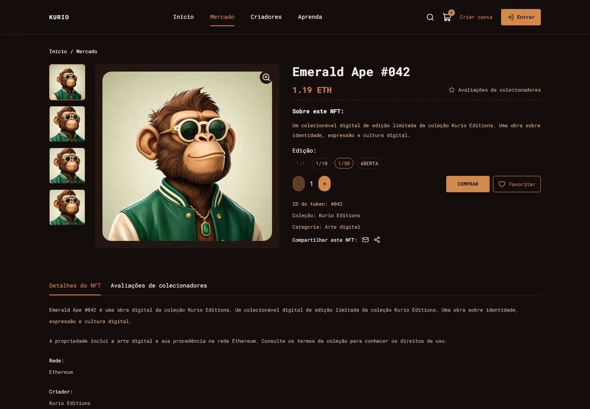
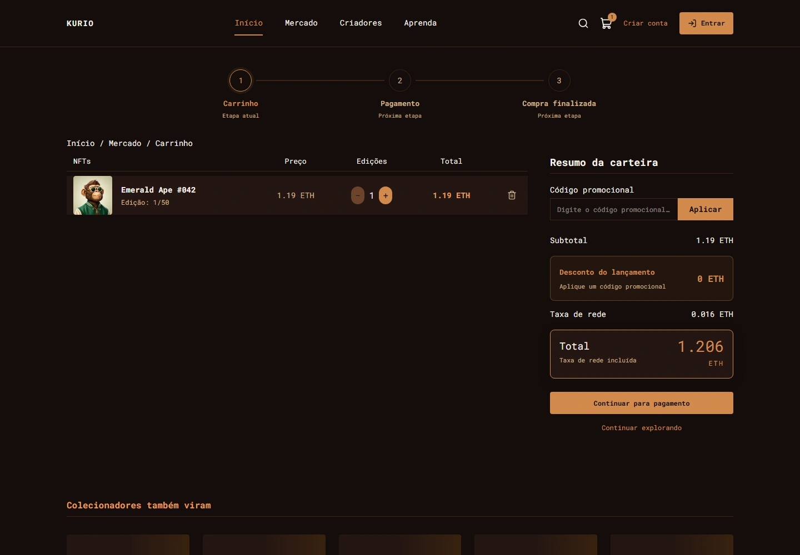
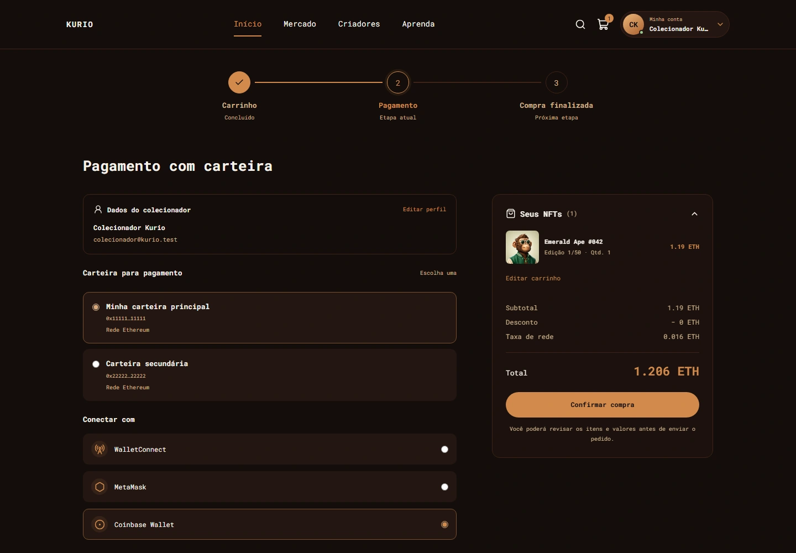
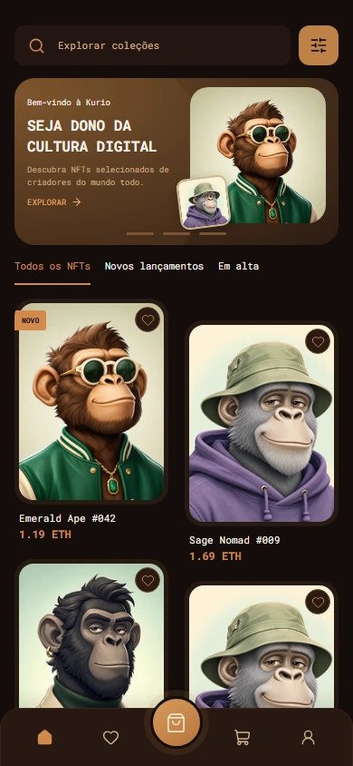
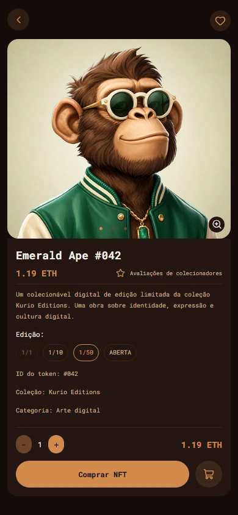
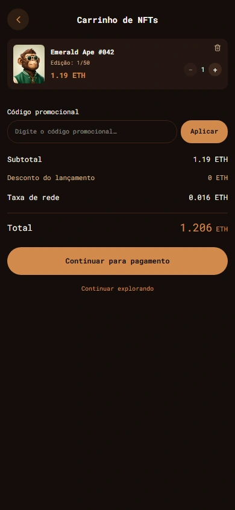
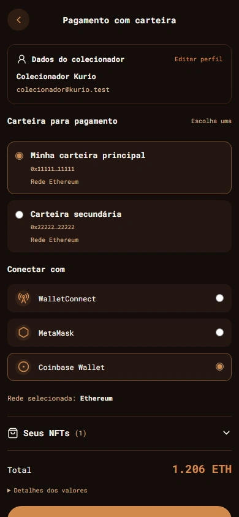

<div align="center">

# KURIO

### Colecione cultura digital.

Marketplace de NFTs com descoberta de coleções, compra simulada e conta do colecionador, em desktop e mobile.

**[Abrir demonstração](https://kurio-nft-marketplace-lake.vercel.app)** · **[Executar localmente](#executar-localmente)** · **[Documentação](#documentação)**

[](https://github.com/henrycsouza/kurio-nft-marketplace/actions/workflows/ci.yml)

</div>


## Sobre o projeto

Projeto desenvolvido para um desafio frontend, com React e TypeScript. As APIs, autenticação, carteiras e pagamentos são simulados com MSW; as atualizações passam pelo cliente Socket.IO. Os dados da demonstração ficam no navegador de cada visitante.

A implementação parte da [referência no Figma](https://www.figma.com/design/8Q3TygU996hKRTqWGylWJq/Untitled?node-id=0-1) e inclui decisões de UX documentadas, como concentrar a edição de dados pessoais no perfil e simplificar a revisão do pagamento.

## Telas

### Desktop

| Descoberta de NFTs | Detalhe da coleção |
| --- | --- |
| [](docs/images/home-desktop.webp) | [](docs/images/nft-desktop.webp) |
| Carrinho | Pagamento |
| [](docs/images/cart-desktop.webp) | [](docs/images/checkout-desktop.webp) |

### Mobile

<p align="center">
  
  
  
  
</p>

As imagens são capturas da versão publicada. Clique nas imagens de desktop para abrir em tamanho maior.

## Funcionalidades

- **Descoberta:** busca, filtros, ordenação e paginação sincronizados com a URL, incluindo refresh e histórico.
- **Coleção:** detalhe, galeria, edições, quantidades, favoritos e disponibilidade por NFT.
- **Compra simulada:** carrinho persistente, cupom, cotação autoritativa, revisão e pedido idempotente com recibo.
- **Conta:** cadastro, login, recuperação de senha, perfil, avatar, carteiras e expiração de sessão.
- **Tempo real:** alterações de preço/estoque, versões de eventos, reconexão e retomada do pedido via REST.
- **Interface:** navegação mobile, carrossel automático, diálogos com foco controlado, skeletons e imagens responsivas.

## Tecnologias

| Responsabilidade | Implementação |
| --- | --- |
| Interface e build | React 19, TypeScript, Vite 8 |
| Navegação e estado remoto | TanStack Router e TanStack Query |
| Rede e simulação | Axios, REST, MSW e Socket.IO |
| Estilização e componentes | Tailwind CSS, shadcn/ui com Base UI e Lucide |
| Precisão de valores em ETH | Decimal.js |
| Qualidade | Playwright, Lighthouse e ESLint |

## Testar a demonstração

**[Acessar Kurio](https://kurio-nft-marketplace-lake.vercel.app)**

| Conta fictícia | Senha |
| --- | --- |
| `colecionador@kurio.test` | `Kurio123!` |
| `ana@kurio.test` | `Kurio123!` |

Escolha um NFT, selecione a edição, adicione ao carrinho, entre na conta e confirme a revisão do pagamento. A confirmação aparece após a resposta da simulação. O cupom `KURIO10` aplica desconto; `EXPIRED` representa um cupom expirado.

O deploy foi validado com seis testes públicos em Chromium, em mobile e desktop, cobrindo arquivos, acesso direto/refresh, login, compra simulada e Socket.IO.

## Executar localmente

Requisitos: **Node.js 22.12+** e npm. Não é necessário serviço privado ou backend externo.

```sh
git clone https://github.com/henrycsouza/kurio-nft-marketplace.git
cd kurio-nft-marketplace
npm ci
npm run dev
```

Os mocks ficam habilitados por padrão, inclusive no build. A variável de exemplo é `VITE_ENABLE_MOCKS=true`. Defina `false` somente quando existir uma API compatível. Fontes e imagens são locais; a sessão simulada dura 30 minutos.

## Comandos

| Comando | Uso |
| --- | --- |
| `npm run dev` | Desenvolvimento com mocks |
| `npm run build` | Verificação TypeScript e build de produção |
| `npm run preview` | Servir o build localmente |
| `npm run typecheck` | Verificação de tipos |
| `npm run lint` | Análise estática |
| `npm run test:checkout` | Integração HTTP e regras de compra/conta |
| `npm run test:e2e` | Testes Playwright |
| `npm run test:visual` | Comparação com as 16 referências visuais |
| `npm run test:loading` | Carregamento do build em quatro larguras |
| `npm run audit:lighthouse -- --label=review --runs=3` | Início e detalhe, mobile/desktop, três medições por caso |
| `npm run docs:screenshots` | Capturas reais e capas deste README |

Antes dos testes de navegador, instale o Chromium:

```sh
npx playwright install chromium
```

Os testes usam larguras de 320, 390, 768 e 1440 px. As referências visuais foram geradas em Chromium/Windows; use o mesmo ambiente para compará-las. Relatórios HTML e traces ficam em `playwright-report/` e `test-results/`.

O workflow de CI executa tipos, lint, integração, build e testes de busca/tempo real em mobile e desktop. As comparações visuais permanecem no ambiente de referência Windows.

## Cenários de avaliação

| Cenário | Como reproduzir |
| --- | --- |
| Pagamento recusado | `/checkout?scenario=declined` |
| Timeout após criação do pedido | `/checkout?scenario=timeout` e ação de recuperação |
| Recusa da carteira | `/checkout?connection=declined` |
| Cupom expirado | Aplicar `EXPIRED` no carrinho |
| Preço/estoque e reconexão | Endpoints MSW em [ARCHITECTURE.md](ARCHITECTURE.md) |
| Catálogo indisponível | `POST /api/demo/catalog` com `{ "unavailable": true }`; usar `false` para recuperar |

Os endpoints de demonstração devem ser chamados pelo console da própria aplicação, onde o MSW está ativo. Para reset manual, feche as outras abas do site, remova as chaves com prefixo `kurio.` de `localStorage` e `sessionStorage` e recarregue. Isso também remove contas, pedidos e carrinhos locais.

## Documentação

| Documento | Conteúdo |
| --- | --- |
| [Arquitetura](ARCHITECTURE.md) | Contratos, cache, isolamento, eventos, reconciliação e decisões de UX |
| [Autenticação](AUTH.md) | Cadastro, sessão, proteção de rotas e recuperação |
| [Compra](CHECKOUT.md) | Cotação, idempotência, snapshot e estados do pedido |
| [Carteiras e preferências](WALLETS_SETTINGS.md) | Persistência e formulários da conta |
| [Responsividade](MOBILE.md) | Adaptações da interface mobile |
| [Performance](PERFORMANCE.md) | Lighthouse, ambiente, métricas e limitações |
| [Revisão do desafio](REVIEW.md) | Requisitos atendidos e lacunas da entrega |
| [Publicação](DEPLOY.md) | Vercel, rotas SPA e validação da URL pública |
| [Componentes](src/components/ui/README.md) | Configuração e adaptação do shadcn/ui |

## Escopo e limitações

A demonstração mantém as simulações exigidas pelo desafio. Permanecem pendências de cenários MSW/reset automatizados, cobertura E2E integral, comparação final com todos os frames e performance mobile abaixo da meta de 90. Os resultados reais estão em [PERFORMANCE.md](PERFORMANCE.md), e a matriz de requisitos está em [REVIEW.md](REVIEW.md). A auditoria Lighthouse do domínio publicado ainda está pendente.

As capturas documentam a interface entregue; não representam uma certificação de equivalência pixel a pixel com o Figma.

---

Desenvolvido por **[Henry Souza](https://github.com/henrycsouza)**.
